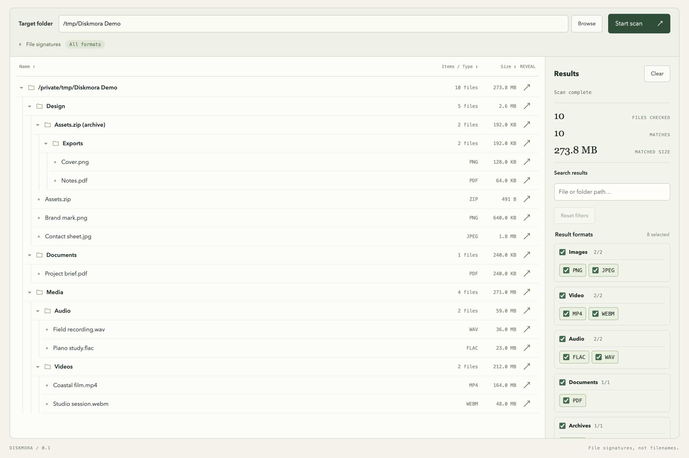

# Diskmora

A local, read-only disk scanner that identifies files by their contents, not their extensions. Built with Tauri 2, React and Rust.

## Preview



Interface preview using a real scan of synthetic sample files. The displayed paths and filenames are demonstration data.

## Features

- Scan a chosen folder recursively, including hidden files and hidden folders.
- Select file signatures by category before scanning.
- Browse a collapsible folder tree with matched file counts and sizes.
- Sort by name, size or type; search paths and filter multiple formats or whole categories without rescanning.
- Inspect files inside ZIP and RAR archives without extracting them to disk.
- Show files in Finder, Windows File Explorer or the system file manager.
- Cancel scans, clear results and inspect skipped directories and read errors.

## Platforms

| Platform | Status |
| --- | --- |
| macOS | Frontend build and Rust tests verified on Apple Silicon. |
| Windows | `x86_64-pc-windows-gnu` cross-compilation check passed; native MSVC packaging and UI still need Windows verification. |
| Linux | Expected to work with Tauri system dependencies; not verified. |

On Windows, build natively with the MSVC Rust toolchain, Microsoft C++ Build Tools with the Desktop development with C++ workload, and Microsoft Edge WebView2. UnRAR also requires the C++ compiler. See the official [Tauri prerequisites](https://v2.tauri.app/start/prerequisites/) for platform setup.

## Development

Prerequisites: Node.js 20.19+ or 22.12+, pnpm 10.32.1, Rust, and your platform's Tauri prerequisites. This repository is self-contained; direct dependency versions and lock files are pinned.

```sh
corepack enable
pnpm install --frozen-lockfile
pnpm tauri-dev
```

`pnpm dev` starts only the frontend preview. Filesystem scanning and native dialogs require `pnpm tauri-dev`.

## Build and verify

```sh
pnpm build
cargo check --manifest-path src-tauri/Cargo.toml --locked
cargo test --manifest-path src-tauri/Cargo.toml --locked --lib
pnpm tauri-build
```

Build the Windows NSIS installer on Windows:

```sh
pnpm exec tauri build --bundles nsis
```

Packages are written under `src-tauri/target/release/bundle/`. Installer execution, signing and file-manager integration require validation on the destination OS.

## Recognized formats

| Category | Formats |
| --- | --- |
| Images | PNG, JPEG, GIF, WEBP, BMP, HEIC |
| Video / containers | MP4, MOV, MKV, WEBM, AVI, FLV, MPEG, TS, M2TS, 3GP, WMV, ASF |
| Audio | MP3, M4A, FLAC, WAV, AAC (ADTS), OGG, OPUS, AIFF/AIFC, AMR/AMR-WB, AC3, APE, WMA |
| Documents | PDF |
| Archives | ZIP, RAR |
| Executables | EXE, ELF |
| Other | Unknown or unsupported signatures |

Detection reads at most the first 4 KiB without extension fallback. A signature indicates a likely format, not a full validation of the file or its codecs. ZIP-based documents appear as ZIP. MKV/WebM are container classifications; ASF is the fallback when Windows Media streams cannot be distinguished within the inspected bytes.

## Archives and result limits

- Archive contents appear as `archive.zip!/folder/file`. Reveal opens the outer archive's location.
- Archives are inspected even when ZIP/RAR containers are excluded by scan signatures.
- ZIP supports stored and Deflate entries and reads up to 4 KiB of decompressed content per entry.
- RAR reads members in memory, with a 64 MiB limit per member and a 256 MiB decompression budget per archive.
- Traversal is limited to 100,000 entries per archive. Nested archives are identified but not opened recursively.
- Encrypted, unsupported, corrupt or over-limit entries are reported and skipped where possible. An unrecoverable archive error skips the remainder of that archive; scanning other files continues.
- The first 2,000 matches are retained for browsing and result filtering. Scan totals include all matches; folder totals reflect the loaded, filtered files.
- Archive entry sizes are uncompressed. Matched totals include matching physical containers and matching entries, so they are not physical disk usage.
- All read errors are counted; details show up to 20 errors. Unreadable directories have a separate list.
- Nested symbolic links are skipped. A selected root is canonicalized. OS permissions still apply.
- Cancellation is checked between entries and waits for an in-flight read to finish. Clear is disabled while scanning.

## Privacy

Scanning stays on the device. The app has no application-level telemetry, accounts or upload endpoint. File paths, results and read errors remain in process memory; the app does not save a scan history. Clear discards the current results. Archives are not extracted to disk and source files are not modified.

Environment files, signing keys, build output and dependencies are excluded by `.gitignore`.

## Project layout

```text
assets/                 Icon source and generation prompt
src/features/scan/      Scan controls, result tree and client state
src-tauri/src/scan/     Filesystem traversal, signatures and archive readers
src-tauri/tests/        Synthetic archive fixtures
src-tauri/icons/        Desktop application icons
```
